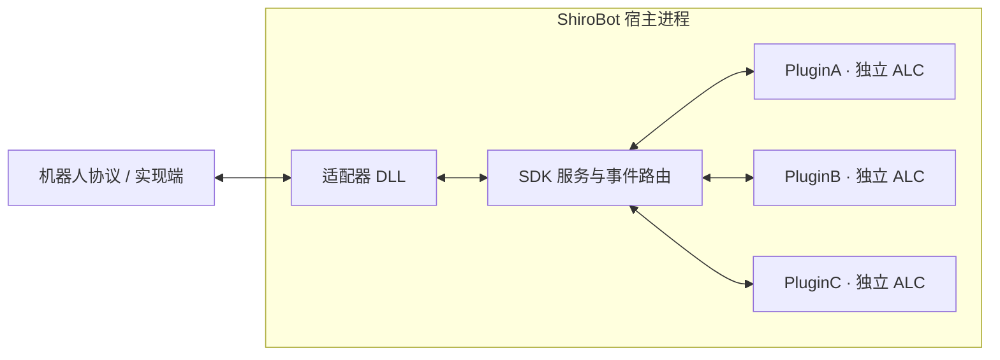

# 认识 ShiroBot

ShiroBot 是基于 C# 和 .NET 11 的机器人宿主，通过适配器接入协议、用插件实现业务：

- **适配器**连接实际机器人协议，负责收发消息、调用协议 API 和上报事件。
- **插件**通过统一 SDK 实现业务功能。
- **宿主**负责配置、插件发现、事件路由、API、热加载和程序集生命周期。

## 运行结构

每个插件使用独立、可回收的 `AssemblyLoadContext`，便于隔离程序集版本和热卸载。所有插件仍运行在同一个宿主进程内，因此共享进程级 GC 堆、JIT 和 native 内存。

## 统一宿主版本

所有发布包都内置 Avalonia、Skia 和 HarfBuzz Headless 渲染。发布文件名只区分 RID 与运行时类型。

所有宿主构建都启用 Avalonia，但渲染初始化仍可能因平台 native 依赖或环境问题失败。插件应检查 `Context.Render`。

## 开发技术栈

- .NET SDK 11
- C# 15 / `net11.0`
- TOML 配置
- NuGet 插件 SDK
- 内置 Avalonia 12.1 Headless 渲染

接下来可以直接[安装 ShiroBot](/guide/installation)，或者进入[插件开发](/plugin/)与[适配器开发](/adapter/)。
