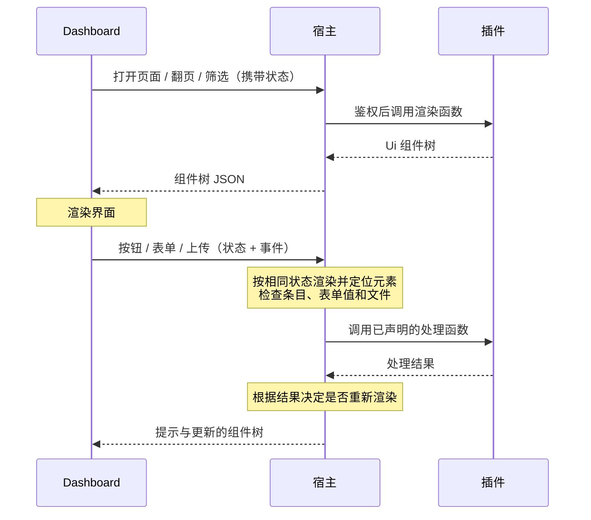
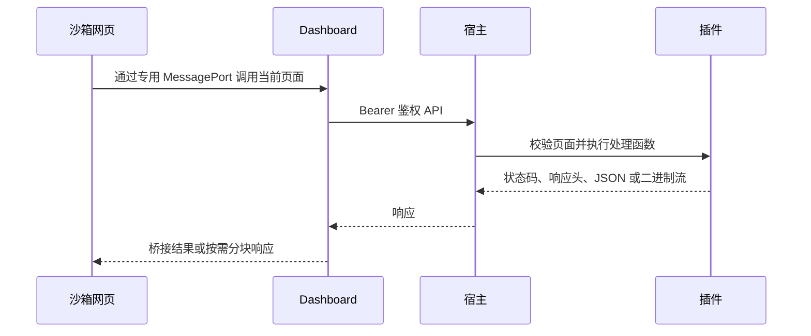

# Dashboard 页面

本文对应当前宿主与 SDK 1.0.2（SDK ABI 1.4.0.0），Dashboard 需支持组件页面契约。

开关、数字和列表用插件配置；表情库、订阅管理、按群编辑规则和统计等复杂界面用 Dashboard 页面。

- 插件用 C# 组合文本、指标、表格、图片网格、表单、按钮和标签页，由 Dashboard 统一渲染，适配主题和手机布局。
- 宿主负责 API 鉴权、数据和图片传输，并将按钮、表单、翻页和筛选事件交给插件处理。
- 页面通过 `Context.Dashboard` 注册，卸载时自动注销，也可随配置增减。
- 页面显示在插件配置窗口的“插件页面”区块。

## 快速上手

一个表情库页面：搜索、按情绪筛选、分页显示图片，每张图可以删除，还能上传新表情。

```csharp
using ShiroBot.SDK.Dashboard;

protected override Task LoadAsync()
{
    Context.Dashboard.AddPage("library", "表情库", RenderLibraryAsync,
        icon: "photo_library", files: OpenImageAsync);
    return Task.CompletedTask;
}

private async Task<UiNode> RenderLibraryAsync(DashboardContext page, CancellationToken ct)
{
    var query = page.Filter("q");
    var emotion = page.Filter("emotion");
    var (memes, total) = await _store.SearchAsync(query, emotion, page.Page(), pageSize: 24, ct);

    return Ui.Column(
        Ui.Filters(
            Ui.Input("q", "搜索"),
            Ui.Select("emotion", "情绪", [("happy", "开心"), ("sad", "难过"), ("daily", "日常")])),
        Ui.Gallery(memes, meme => new UiCard(meme.Id, meme.Caption,
                Image: meme.Id, Description: string.Join(" · ", meme.Emotions), Tags: meme.Tags))
            .Action("delete", "删除", DeleteAsync, confirm: "确定删除这个表情？", danger: true),
        Ui.Pager(total, pageSize: 24),
        Ui.Upload("import", "上传表情", ImportAsync, accept: ["image/*"], maxBytes: 5_000_000));
}

private async Task<DashboardResult> DeleteAsync(Meme meme, DashboardEvent e, CancellationToken ct) =>
    await _store.RemoveAsync(meme.Id, ct) ? DashboardResult.Done("已删除") : DashboardResult.Error("表情不存在");

private Task<DashboardFile?> OpenImageAsync(string fileId, CancellationToken ct) =>
    Task.FromResult(_store.Find(fileId) is { } meme ? DashboardFile.FromPath(meme.FilePath, meme.Mime) : null);
```

## 复杂一点的页面

按群设置规则：用标签页分开“规则”和“新建”，规则表格里每行可以编辑和删除，顶部显示统计。

```csharp
Context.Dashboard.AddPage("rules", "群规则", async (page, ct) =>
{
    var rules = await _rules.ListAsync(ct);
    return Ui.Column(
        Ui.Row(
            Ui.Metric("已设置的群", rules.Count.ToString()),
            Ui.Metric("关闭采集", rules.Count(rule => !rule.Collect).ToString(), hint: "这些群不会自动收表情")),
        Ui.Tabs("view",
            Ui.Tab("list", "规则",
                Ui.Table(rules, rule => rule.GroupId)
                    .Column("群", rule => rule.GroupId)
                    .Column("自动采集", rule => rule.Collect ? "开" : "关")
                    .Column("冷却", rule => $"{rule.Cooldown} 秒")
                    .Action("edit", "编辑", (rule, e, ct) => Task.FromResult(DashboardResult.OpenForm("edit", rule)))
                    .Action("delete", "删除", DeleteRuleAsync, confirm: "确定删除这条规则？", danger: true),
                Ui.Empty("还没有单独设置的群。", when: rules.Count == 0)),
            Ui.Tab("create", "新建",
                Ui.Form<GroupRule>("create").Submit("保存", SaveRuleAsync))),
        Ui.Form<GroupRule>("edit").AsDialog().Submit("保存", SaveRuleAsync));
}, icon: "rule");

[PluginJson]
public sealed record GroupRule(
    [property: Description("群"), UiField(Kind = UiFieldKind.Group)] string GroupId,
    [property: Description("自动采集")] bool Collect = true,
    [property: Description("冷却（秒）"), Range(0, 3600)] int Cooldown = 45);

private async Task<DashboardResult> SaveRuleAsync(GroupRule rule, DashboardEvent e, CancellationToken ct)
{
    await _rules.SaveAsync(rule, ct);
    return DashboardResult.Done("已保存").SwitchTab("view", "list");
}
```

`Ui.Form<GroupRule>()` 按 record 生成表单：字段类型、默认值、`[Description]` 说明、`[Range]` 范围、必填都取自 record，群和好友字段用 Dashboard 现有的选择器。提交时宿主先校验，再把读好的 `GroupRule` 交给处理函数。需要更灵活的表单时也可以逐个声明字段，见[表单](#表单)。

## 多个页面

每次调用 `AddPage` 注册一个页面，各页面的渲染函数、状态和文件读取相互独立。配置窗口的“插件页面”区块按 `order` 排序：

```csharp
protected override Task LoadAsync()
{
    Context.Dashboard.AddPage("library", "表情库", RenderLibraryAsync, icon: "photo_library", order: 10, files: OpenImageAsync);
    Context.Dashboard.AddPage("rules", "群规则", RenderRulesAsync, icon: "rule", order: 20);
    Context.Dashboard.AddPage("stats", "统计", RenderStatsAsync, icon: "monitoring", order: 30);
    return Task.CompletedTask;
}
```

页面较多时可拆为独立的类，在 `LoadAsync` 中注册：

```csharp
internal sealed class LibraryPage(MemeStore store)
{
    public void Register(IPluginDashboard dashboard) =>
        dashboard.AddPage("library", "表情库", RenderAsync, icon: "photo_library", files: OpenImageAsync);

    private async Task<UiNode> RenderAsync(DashboardContext page, CancellationToken ct) { /* … */ }
    private Task<DashboardFile?> OpenImageAsync(string fileId, CancellationToken ct) { /* … */ }
}

// LoadAsync 里
new LibraryPage(_store).Register(Context.Dashboard);
new RulesPage(_rules).Register(Context.Dashboard);
```

- **页面之间跳转**：处理结果用 `.OpenPage("rules")` 打开另一个页面，可以带上筛选值，例如 `.OpenPage("library", ("q", "猫"))`；内容里也可以放 `Ui.Link("查看规则", page: "rules")`。
- **按需出现**：页面可以随配置增减，例如开启 AI 标注时才注册“标注统计”页，关闭时 `Dispose`。
- **一个页面里的分区**：内容不多、彼此相关的，用 `Ui.Tabs` 放在同一个页面里；相对独立、各自有筛选和分页的，拆成多个页面。

## 页面是怎么工作的



- **页面状态**：Dashboard 保存筛选值、页码和当前标签页，随每次渲染和事件请求发送。渲染函数用 `page.Filter("q")`、`page.Page()`、`page.Tab("view")` 读取。
- **处理函数随渲染一起声明**：按钮、行操作和表单在渲染时声明处理函数。收到事件后，宿主按相同状态重新渲染，通过元素 ID 定位处理函数。因此渲染函数只能依赖页面状态和插件数据，不能依赖上次渲染的临时状态。
- **条目由宿主找回**：表格、图片网格、列表的操作处理函数直接收到条目对象（上例的 `Meme`、`GroupRule`），宿主从重新渲染的数据里按 key 找到它。不在当前数据里的条目（例如已被删除）不会交给插件，Dashboard 提示“内容已变化，请刷新”。
- **一次往返**：处理函数返回后，宿主默认再渲染一次，把提示和新的组件树一起返回。

## 组件

组件都由静态类 `Ui` 创建，可以任意嵌套。

### 布局

| 组件 | 说明 |
| --- | --- |
| `Ui.Column(...)` | 纵向排列 |
| `Ui.Row(...)` | 横向排列，窄屏自动换行 |
| `Ui.Card(title, ...)` | 带标题的分组卡片 |
| `Ui.Tabs(id, Ui.Tab(id, title, ...), ...)` | 标签页，当前标签记在状态里 |
| `Ui.Divider()` | 分隔线 |

### 内容

| 组件 | 说明 |
| --- | --- |
| `Ui.Text(text)` / `Ui.Markdown(markdown)` | 文本；Markdown 只支持基本格式，不渲染 HTML |
| `Ui.Notice(text, tone)` | 提示条：`info`、`success`、`warning`、`danger` |
| `Ui.Metric(label, value, hint)` | 一个统计数字 |
| `Ui.Image(fileId, alt)` | 图片，通过页面的 `files` 读取 |
| `Ui.Code(text)` | 等宽文本，例如日志或配置片段 |
| `Ui.Link(text, page:)` | 跳到插件的另一个页面；也可以用 `url:` 打开外部链接 |
| `Ui.Empty(text, when)` | 空状态，`when` 为 false 时不显示 |

### 数据

| 组件 | 说明 |
| --- | --- |
| `Ui.Table(items, key)` | 表格；`.Column(title, value)` 声明列 |
| `Ui.Gallery(items, card)` | 卡片网格，适合图片；`UiCard` 有标题、描述、图片、标签和次要信息 |
| `Ui.List(items, card)` | 纵向列表，卡片字段同上 |
| `.Action(id, label, handler, confirm, danger, when)` | 条目上的操作；`when: item => …` 只对部分条目显示 |
| `Ui.Filters(...)` | 筛选栏：`Ui.Input`、`Ui.Select`、`Ui.Switch`，值记在状态里 |
| `Ui.Pager(total, pageSize)` | 分页，页码记在状态里；不知道总数时用 `hasMore:` |

### 交互

| 组件 | 说明 |
| --- | --- |
| `Ui.Button(id, label, handler, confirm, danger)` | 按钮 |
| `Ui.Form(id)` / `Ui.Form<T>(id)` | 表单，见下文 |
| `Ui.Upload(id, label, handler, accept, maxBytes)` | 上传文件；宿主按大小限流读取，单文件上限 20 MB |

## 表单

逐个声明字段：

```csharp
Ui.Form("notify")
    .Text("title", "标题", required: true, maxLength: 40)
    .TextArea("body", "内容")
    .Select("level", "级别", [("info", "普通"), ("urgent", "紧急")], value: "info")
    .Groups("groups", "发送到", required: true)
    .Switch("mention", "@全体成员")
    .Submit("发送", async (form, e, ct) =>
    {
        await SendAsync(form.Get<string>("title"), form.Get<string>("body"), form.Get<string[]>("groups"), ct);
        return DashboardResult.Done("已发送");
    });
```

| 字段 | 说明 |
| --- | --- |
| `Text` / `TextArea` / `Secret` | 文本、多行文本、密码；均支持 `required`，前两者支持 `maxLength`，`Text` 还支持 `pattern` |
| `Number` | 数字；可选 `min`、`max` |
| `Switch` | 开关 |
| `Select` / `MultiSelect` | 单选、多选，值必须在选项里 |
| `Users` / `Groups` | 好友、群选择器，和配置里的一样 |

调用处理函数前，宿主只接受已声明的字段，并检查类型、必填、长度、范围和选项。校验失败时，Dashboard 在对应字段下显示原因，不调用插件。

## 处理结果

处理函数返回 `DashboardResult`：

| 写法 | 说明 |
| --- | --- |
| `DashboardResult.Done(message)` | 成功，提示 `message` 并刷新页面 |
| `DashboardResult.Error(message)` | 失败，提示原因，不刷新 |
| `.WithDetails(title, text)` | 另外在居中的对话框里显示较长的内容，例如导入报告 |
| `.SwitchTab(tabsId, tabId)` | 切换到某个标签页 |
| `.OpenPage(pageId, filters…)` | 打开插件的另一个页面，可以带上筛选值 |
| `.NoRefresh()` | 不重新渲染 |
| `DashboardResult.OpenForm(formId, value)` | 打开表单并填好值，用于“编辑” |

## 文件和图片

`AddPage` 的 `files` 参数读取页面里引用的文件：`Ui.Image`、`UiCard.Image` 里的文件 ID 都通过它读取。

- `DashboardFile.FromPath` 交出磁盘上的文件，`FromBytes` 交出内存中的内容。
- 宿主在插件调用结束前打开独立的文件流或复制字节；响应期间不保留插件对象，不影响插件热更新。

## 生命周期

- `AddPage` 返回 `IDisposable`，页面登记在插件的生命周期上，卸载时自动注销。
- 可以随配置增减页面，例如开启 AI 标注时才 `AddPage("tagging", …)`，关闭时 `Dispose`。Dashboard 下次打开插件时就能看到变化。
- 页面 ID 在插件内唯一，重复注册会抛出异常。

## 出错时

- 渲染函数或处理函数抛出异常时，Dashboard 显示失败原因，不影响宿主和其他插件。
- 插件正在卸载时，页面提示稍后再试。
- 事件找不到对应的元素或条目（页面已经变化）时，Dashboard 提示刷新。

## 自定义网页

画布编辑器、拖拽排版等界面可以用 `AddWebPage` 注册。前端以自包含 HTML 嵌入插件 DLL，Dashboard 在沙箱 iframe 中打开。Vue 等框架需打包成单 HTML，将脚本和样式内联；相对路径的 JS 模块、动态分包和直接网络请求暂不支持。额外资源通过桥接读取。

### 注册页面

项目文件中嵌入资源，并保留相对路径：

```xml
<ItemGroup>
  <EmbeddedResource Include="Web/**/*"
      LogicalName="dashboard/%(RecursiveDir)%(Filename)%(Extension)" />
</ItemGroup>
```

`Web/index.html` 为入口，注册时指定同一资源前缀：

```csharp
using System.Text.Json.Nodes;
using ShiroBot.SDK.Dashboard;

Context.Dashboard.AddWebPage("editor", "编辑器",
    new DashboardWebPage(typeof(Plugin).Assembly, "dashboard/")
    {
        Icon = "edit",
        EntryPoint = "index.html",
        HandleAsync = async (action, arguments, ct) =>
        {
            if (action != "save") throw new ArgumentException("未知操作。");
            var text = arguments?["text"]?.GetValue<string>();
            if (text is null || text.Length > 2000)
                throw new ArgumentException("内容不能为空且最多 2000 字符。");
            await SaveAsync(text, ct);
            return new JsonObject { ["saved"] = true };
        }
    });
```

`DashboardWebPage` 的 `EntryPoint` 默认为 `index.html`，还可设置 `Icon`、`Description`、`Order`、JSON 操作 `HandleAsync` 和通用 HTTP 入口 `RequestAsync`。页面 ID 与组件页面共用唯一性规则；返回的注册对象可提前 `Dispose`，插件卸载时自动注销。

### 网页桥接

宿主在插件脚本之前提供 `window.ShiroBotDashboard`。调用会等待桥接连接，返回 Promise：

```html
<button id="save">保存</button>
<script>
  document.querySelector('#save').onclick = async () => {
    try {
      const result = await window.ShiroBotDashboard.call('save', { text: '你好' });
      console.log(result.saved);
    } catch (error) {
      console.error(error.message);
    }
  };
</script>
```

| 方法 | 返回 | 用途 |
| --- | --- | --- |
| `ready` | `Promise<void>` | 桥接连接完成 |
| `request(path, init)` | `Promise<Response>` | 请求当前页面的业务 HTTP 入口，支持文本、JSON、表单、文件和二进制响应 |
| `call(action, arguments)` | `Promise<unknown>` | 调用当前页面的 `HandleAsync`，参数和结果为 JSON |
| `asset(path)` | `Promise<Blob>` | 读取资源前缀下的嵌入文件，例如 `images/cat.png` |
| `assetUrl(path)` | `Promise<string>` | 为资源创建本页可用的 Blob URL，可用于图片、字体和媒体 |
| `revokeAssetUrl(url)` | `void` | 释放不再使用的 Blob URL；离开页面时也会统一清理 |

```javascript
const url = await window.ShiroBotDashboard.assetUrl('images/cat.png');
document.querySelector('img').src = url;
// 替换图片、不再使用时释放。
window.ShiroBotDashboard.revokeAssetUrl(url);
```

处理函数应校验操作名、参数格式和业务权限，并响应 `CancellationToken`。`call` 的成功表示函数正常返回，业务失败可用自己的 JSON 结构表示或抛出异常；异常会让 Promise 拒绝。请求及结果上限为 1 MB，入口 HTML 上限为 2 MB，单个资源上限为 20 MB，同时最多处理 32 个桥接请求。

### 通用 HTTP 请求与文件传输

插件通过 `RequestAsync` 接收页面内的 HTTP 请求。使用标准 ASP.NET `HttpRequest` 读取路径、方法、查询参数、请求头和请求体，返回 `IResult`：

```csharp
using Microsoft.AspNetCore.Http;

Context.Dashboard.AddWebPage("files", "文件管理",
    new DashboardWebPage(typeof(Plugin).Assembly, "dashboard/")
    {
        RequestAsync = async (request, ct) =>
        {
            if (request.Method == "POST" && request.Path == "/images/upload")
            {
                var form = await request.ReadFormAsync(ct);
                if (form.Files.GetFile("image") is not { } file)
                    return Results.BadRequest(new { error = "缺少图片。" });
                // 检查文件内容和业务权限后保存；文件名仅用于显示。
                await SaveImageAsync(file, ct);
                return Results.Json(new { saved = true });
            }
            if (request.Method is "GET" or "HEAD" && request.Path == "/video")
                return Results.File(videoPath, "video/mp4", enableRangeProcessing: true);
            return Results.NotFound();
        },
        MaxRequestBytes = 256 * 1024 * 1024,
        MaxResponseBytes = 256 * 1024 * 1024
    });
```

网页以类似 `fetch` 的方式调用，路径始终相对于当前插件页面：

```javascript
const dashboard = window.ShiroBotDashboard;
const form = new FormData();
form.append('image', fileInput.files[0]);
const response = await dashboard.request('/images/upload', {
  method: 'POST', body: form
});
if (!response.ok) throw new Error(await response.text());
console.log(await response.json());
```

请求体支持字符串、`Blob`、`File`、`FormData`、`URLSearchParams`、`ArrayBuffer` 和二进制数组。JSON 使用 `JSON.stringify` 并设置 `Content-Type: application/json`。FormData 的 multipart 边界由浏览器生成。

返回值为 `Response`，保留业务状态码及内容类型。用 `json()`、`text()`、`blob()`、`arrayBuffer()` 读取，也可逐块消费 `response.body`。HTTP 4xx/5xx 通过 `response.ok` 检查；网络故障和取消会使请求或响应流失败。

```javascript
const controller = new AbortController();
const response = await dashboard.request('/video', {
  headers: { Range: 'bytes=0-1048575' },
  signal: controller.signal
});
console.log(response.status, response.headers.get('Content-Range'));
const data = await response.arrayBuffer();
// 取消尚未完成的请求或读取：controller.abort();
```

完整下载后，可用 `URL.createObjectURL(await response.blob())` 给图片、视频或下载链接设置地址，使用完调用 `URL.revokeObjectURL`。直接把业务 API 地址赋给 `<video src>` 或 `` 无法经过桥接鉴权；分段读取通过 `request()` 的 Range 请求完成。

请求和响应体默认各限 256 MiB，可用 `MaxRequestBytes`、`MaxResponseBytes` 调整，宿主硬上限为 1 GiB。上传保留 Blob/File 和表单中的二进制内容；响应通过专用 MessagePort 按需拉取分块，避免父页面一次读入整段文件。调用 `blob()` 或 `arrayBuffer()` 会在网页中收集完整响应，长数据可用 `response.body` 流式读取。放弃读取时调用 `response.body.cancel()`，释放上游传输。

常用内容、条件请求、Range 请求头及业务 `X-*` 头可传递；Authorization、Cookie、Host、转发身份头和鉴权类头由宿主管理。响应保留 Content-Type、Content-Length、Content-Disposition、Content-Range、Accept-Ranges、ETag、Last-Modified 和业务 `X-*` 头。重定向、Set-Cookie、CSP 等控制头由宿主隔离。

处理函数和响应发送都计入插件活动调用。刷新页面、切换页面、显式取消或插件卸载会取消传输；响应流发送完毕后释放，multipart 临时文件随后清理。插件应将收到的取消令牌继续传给文件和网络操作。

### 鉴权与隔离



iframe 仅允许脚本执行，使用独立来源。API 密钥由 Dashboard 保存，网页通过绑定当前插件和页面的桥接通信。资源读取和函数调用均经过宿主 Bearer 鉴权；网页不能指定其他插件、页面或任意 API 地址。宿主只读取指定程序集资源前缀下的文件，拒绝路径穿越。

网页 CSP 限制直接联网、子框架和表单提交。刷新、切换页面或卸载插件时，桥接请求会取消；iframe 导航后关闭桥接，需要用户刷新页面重新打开。第三方脚本、样式和字体应在构建时打包，远程业务数据通过插件处理函数获取。

完整可运行示例位于 `Templates/Examples/DashboardWeb`。现有 `AddPage` 组件页面继续使用原有接口。
