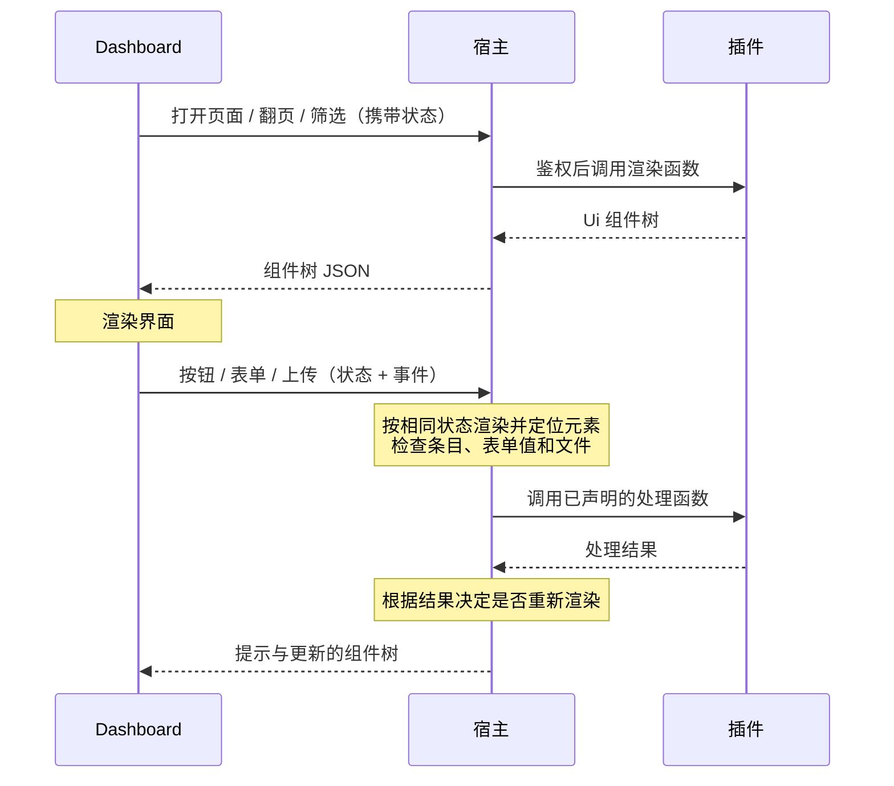

# Dashboard 页面

本文对应当前宿主与 SDK 1.0.2（SDK ABI 1.4.0.0），Dashboard 需支持组件页面契约。

开关、数字和列表用插件配置；表情库、订阅管理、按群编辑规则和统计等复杂界面用 Dashboard 页面。

- 插件用 C# 组合文本、指标、表格、图片网格、表单、按钮和标签页，由 Dashboard 统一渲染，适配主题和手机布局。
- 宿主负责 API 鉴权、数据和图片传输，并将按钮、表单、翻页和筛选事件交给插件处理。
- 页面通过 `Context.Dashboard` 注册，卸载时自动注销，也可随配置增减。
- 页面显示在插件配置窗口的“插件页面”区块。

## 快速上手

一个表情库页面：搜索、按情绪筛选、分页显示图片，每张图可以删除，还能上传新表情。

```csharp
using ShiroBot.SDK.Dashboard;

protected override Task LoadAsync()
{
    Context.Dashboard.AddPage("library", "表情库", RenderLibraryAsync,
        icon: "photo_library", files: OpenImageAsync);
    return Task.CompletedTask;
}

private async Task<UiNode> RenderLibraryAsync(DashboardContext page, CancellationToken ct)
{
    var query = page.Filter("q");
    var emotion = page.Filter("emotion");
    var (memes, total) = await _store.SearchAsync(query, emotion, page.Page(), pageSize: 24, ct);

    return Ui.Column(
        Ui.Filters(
            Ui.Input("q", "搜索"),
            Ui.Select("emotion", "情绪", [("happy", "开心"), ("sad", "难过"), ("daily", "日常")])),
        Ui.Gallery(memes, meme => new UiCard(meme.Id, meme.Caption,
                Image: meme.Id, Description: string.Join(" · ", meme.Emotions), Tags: meme.Tags))
            .Action("delete", "删除", DeleteAsync, confirm: "确定删除这个表情？", danger: true),
        Ui.Pager(total, pageSize: 24),
        Ui.Upload("import", "上传表情", ImportAsync, accept: ["image/*"], maxBytes: 5_000_000));
}

private async Task<DashboardResult> DeleteAsync(Meme meme, DashboardEvent e, CancellationToken ct) =>
    await _store.RemoveAsync(meme.Id, ct) ? DashboardResult.Done("已删除") : DashboardResult.Error("表情不存在");

private Task<DashboardFile?> OpenImageAsync(string fileId, CancellationToken ct) =>
    Task.FromResult(_store.Find(fileId) is { } meme ? DashboardFile.FromPath(meme.FilePath, meme.Mime) : null);
```

## 复杂一点的页面

按群设置规则：用标签页分开“规则”和“新建”，规则表格里每行可以编辑和删除，顶部显示统计。

```csharp
Context.Dashboard.AddPage("rules", "群规则", async (page, ct) =>
{
    var rules = await _rules.ListAsync(ct);
    return Ui.Column(
        Ui.Row(
            Ui.Metric("已设置的群", rules.Count.ToString()),
            Ui.Metric("关闭采集", rules.Count(rule => !rule.Collect).ToString(), hint: "这些群不会自动收表情")),
        Ui.Tabs("view",
            Ui.Tab("list", "规则",
                Ui.Table(rules, rule => rule.GroupId)
                    .Column("群", rule => rule.GroupId)
                    .Column("自动采集", rule => rule.Collect ? "开" : "关")
                    .Column("冷却", rule => $"{rule.Cooldown} 秒")
                    .Action("edit", "编辑", (rule, e, ct) => Task.FromResult(DashboardResult.OpenForm("edit", rule)))
                    .Action("delete", "删除", DeleteRuleAsync, confirm: "确定删除这条规则？", danger: true),
                Ui.Empty("还没有单独设置的群。", when: rules.Count == 0)),
            Ui.Tab("create", "新建",
                Ui.Form<GroupRule>("create").Submit("保存", SaveRuleAsync))),
        Ui.Form<GroupRule>("edit").AsDialog().Submit("保存", SaveRuleAsync));
}, icon: "rule");

[PluginJson]
public sealed record GroupRule(
    [property: Description("群"), UiField(Kind = UiFieldKind.Group)] string GroupId,
    [property: Description("自动采集")] bool Collect = true,
    [property: Description("冷却（秒）"), Range(0, 3600)] int Cooldown = 45);

private async Task<DashboardResult> SaveRuleAsync(GroupRule rule, DashboardEvent e, CancellationToken ct)
{
    await _rules.SaveAsync(rule, ct);
    return DashboardResult.Done("已保存").SwitchTab("view", "list");
}
```

`Ui.Form<GroupRule>()` 按 record 生成表单：字段类型、默认值、`[Description]` 说明、`[Range]` 范围、必填都取自 record，群和好友字段用 Dashboard 现有的选择器。提交时宿主先校验，再把读好的 `GroupRule` 交给处理函数。需要更灵活的表单时也可以逐个声明字段，见[表单](#表单)。

## 多个页面

每次调用 `AddPage` 注册一个页面，各页面的渲染函数、状态和文件读取相互独立。配置窗口的“插件页面”区块按 `order` 排序：

```csharp
protected override Task LoadAsync()
{
    Context.Dashboard.AddPage("library", "表情库", RenderLibraryAsync, icon: "photo_library", order: 10, files: OpenImageAsync);
    Context.Dashboard.AddPage("rules", "群规则", RenderRulesAsync, icon: "rule", order: 20);
    Context.Dashboard.AddPage("stats", "统计", RenderStatsAsync, icon: "monitoring", order: 30);
    return Task.CompletedTask;
}
```

页面较多时可拆为独立的类，在 `LoadAsync` 中注册：

```csharp
internal sealed class LibraryPage(MemeStore store)
{
    public void Register(IPluginDashboard dashboard) =>
        dashboard.AddPage("library", "表情库", RenderAsync, icon: "photo_library", files: OpenImageAsync);

    private async Task<UiNode> RenderAsync(DashboardContext page, CancellationToken ct) { /* … */ }
    private Task<DashboardFile?> OpenImageAsync(string fileId, CancellationToken ct) { /* … */ }
}

// LoadAsync 里
new LibraryPage(_store).Register(Context.Dashboard);
new RulesPage(_rules).Register(Context.Dashboard);
```

- **页面之间跳转**：处理结果用 `.OpenPage("rules")` 打开另一个页面，可以带上筛选值，例如 `.OpenPage("library", ("q", "猫"))`；内容里也可以放 `Ui.Link("查看规则", page: "rules")`。
- **按需出现**：页面可以随配置增减，例如开启 AI 标注时才注册“标注统计”页，关闭时 `Dispose`。
- **一个页面里的分区**：内容不多、彼此相关的，用 `Ui.Tabs` 放在同一个页面里；相对独立、各自有筛选和分页的，拆成多个页面。

## 页面是怎么工作的



- **页面状态**：Dashboard 保存筛选值、页码和当前标签页，随每次渲染和事件请求发送。渲染函数用 `page.Filter("q")`、`page.Page()`、`page.Tab("view")` 读取。
- **处理函数随渲染一起声明**：按钮、行操作和表单在渲染时声明处理函数。收到事件后，宿主按相同状态重新渲染，通过元素 ID 定位处理函数。因此渲染函数只能依赖页面状态和插件数据，不能依赖上次渲染的临时状态。
- **条目由宿主找回**：表格、图片网格、列表的操作处理函数直接收到条目对象（上例的 `Meme`、`GroupRule`），宿主从重新渲染的数据里按 key 找到它。不在当前数据里的条目（例如已被删除）不会交给插件，Dashboard 提示“内容已变化，请刷新”。
- **一次往返**：处理函数返回后，宿主默认再渲染一次，把提示和新的组件树一起返回。

## 组件

组件都由静态类 `Ui` 创建，可以任意嵌套。

### 布局

| 组件 | 说明 |
| --- | --- |
| `Ui.Column(...)` | 纵向排列 |
| `Ui.Row(...)` | 横向排列，窄屏自动换行 |
| `Ui.Card(title, ...)` | 带标题的分组卡片 |
| `Ui.Tabs(id, Ui.Tab(id, title, ...), ...)` | 标签页，当前标签记在状态里 |
| `Ui.Divider()` | 分隔线 |

### 内容

| 组件 | 说明 |
| --- | --- |
| `Ui.Text(text)` / `Ui.Markdown(markdown)` | 文本；Markdown 只支持基本格式，不渲染 HTML |
| `Ui.Notice(text, tone)` | 提示条：`info`、`success`、`warning`、`danger` |
| `Ui.Metric(label, value, hint)` | 一个统计数字 |
| `Ui.Image(fileId, alt)` | 图片，通过页面的 `files` 读取 |
| `Ui.Code(text)` | 等宽文本，例如日志或配置片段 |
| `Ui.Link(text, page:)` | 跳到插件的另一个页面；也可以用 `url:` 打开外部链接 |
| `Ui.Empty(text, when)` | 空状态，`when` 为 false 时不显示 |

### 数据

| 组件 | 说明 |
| --- | --- |
| `Ui.Table(items, key)` | 表格；`.Column(title, value)` 声明列 |
| `Ui.Gallery(items, card)` | 卡片网格，适合图片；`UiCard` 有标题、描述、图片、标签和次要信息 |
| `Ui.List(items, card)` | 纵向列表，卡片字段同上 |
| `.Action(id, label, handler, confirm, danger, when)` | 条目上的操作；`when: item => …` 只对部分条目显示 |
| `Ui.Filters(...)` | 筛选栏：`Ui.Input`、`Ui.Select`、`Ui.Switch`，值记在状态里 |
| `Ui.Pager(total, pageSize)` | 分页，页码记在状态里；不知道总数时用 `hasMore:` |

### 交互

| 组件 | 说明 |
| --- | --- |
| `Ui.Button(id, label, handler, confirm, danger)` | 按钮 |
| `Ui.Form(id)` / `Ui.Form<T>(id)` | 表单，见下文 |
| `Ui.Upload(id, label, handler, accept, maxBytes)` | 上传文件；宿主按大小限流读取，单文件上限 20 MB |

## 表单

逐个声明字段：

```csharp
Ui.Form("notify")
    .Text("title", "标题", required: true, maxLength: 40)
    .TextArea("body", "内容")
    .Select("level", "级别", [("info", "普通"), ("urgent", "紧急")], value: "info")
    .Groups("groups", "发送到", required: true)
    .Switch("mention", "@全体成员")
    .Submit("发送", async (form, e, ct) =>
    {
        await SendAsync(form.Get<string>("title"), form.Get<string>("body"), form.Get<string[]>("groups"), ct);
        return DashboardResult.Done("已发送");
    });
```

| 字段 | 说明 |
| --- | --- |
| `Text` / `TextArea` / `Secret` | 文本、多行文本、密码；均支持 `required`，前两者支持 `maxLength`，`Text` 还支持 `pattern` |
| `Number` | 数字；可选 `min`、`max` |
| `Switch` | 开关 |
| `Select` / `MultiSelect` | 单选、多选，值必须在选项里 |
| `Users` / `Groups` | 好友、群选择器，和配置里的一样 |

调用处理函数前，宿主只接受已声明的字段，并检查类型、必填、长度、范围和选项。校验失败时，Dashboard 在对应字段下显示原因，不调用插件。

## 处理结果

处理函数返回 `DashboardResult`：

| 写法 | 说明 |
| --- | --- |
| `DashboardResult.Done(message)` | 成功，提示 `message` 并刷新页面 |
| `DashboardResult.Error(message)` | 失败，提示原因，不刷新 |
| `.WithDetails(title, text)` | 另外在居中的对话框里显示较长的内容，例如导入报告 |
| `.SwitchTab(tabsId, tabId)` | 切换到某个标签页 |
| `.OpenPage(pageId, filters…)` | 打开插件的另一个页面，可以带上筛选值 |
| `.NoRefresh()` | 不重新渲染 |
| `DashboardResult.OpenForm(formId, value)` | 打开表单并填好值，用于“编辑” |

## 文件和图片

`AddPage` 的 `files` 参数读取页面里引用的文件：`Ui.Image`、`UiCard.Image` 里的文件 ID 都通过它读取。

- `DashboardFile.FromPath` 交出磁盘上的文件，`FromBytes` 交出内存中的内容。
- 宿主在插件调用结束前打开独立的文件流或复制字节；响应期间不保留插件对象，不影响插件热更新。

## 生命周期

- `AddPage` 返回 `IDisposable`，页面登记在插件的生命周期上，卸载时自动注销。
- 可以随配置增减页面，例如开启 AI 标注时才 `AddPage("tagging", …)`，关闭时 `Dispose`。Dashboard 下次打开插件时就能看到变化。
- 页面 ID 在插件内唯一，重复注册会抛出异常。

## 出错时

- 渲染函数或处理函数抛出异常时，Dashboard 显示失败原因，不影响宿主和其他插件。
- 插件正在卸载时，页面提示稍后再试。
- 事件找不到对应的元素或条目（页面已经变化）时，Dashboard 提示刷新。

## 以后：自定义网页

拖拽排版、画布编辑器、实时预览等界面，未来可考虑通过 `AddWebPage` 支持：前端文件打包进插件 DLL，由宿主经鉴权接口提供，在禁止同源访问的沙箱 iframe 中运行，通过桥接脚本调用插件处理函数。该方案尚未提供，待有实际需求时再实现。
